<picture>
  <source media="(prefers-color-scheme: dark)" srcset="assets/banner-dark.png">
  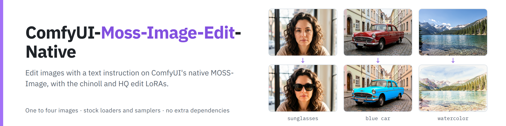
</picture>

<p align="center">
  <a href="https://github.com/Comfy-Org/ComfyUI/releases"></a>
  <a href="https://huggingface.co/Comfy-Org/MOSS-Image"></a>
  <a href="#supported-loras"></a>
  <a href="#install"></a>
  <a href="#credits-and-license"></a>
</p>

<p align="center">
  <a href="https://huggingface.co/PedroMarinhoDev/Moss-Image-Edit-ComfyUI/resolve/main/moss-image-edit-promo.mp4"><b>Watch the overview (62 s)</b></a> ·
  <a href="#install">Install</a> ·
  <a href="#workflows">Workflows</a> ·
  <a href="#gallery">Gallery</a> ·
  <a href="#recommended-settings">Settings</a> ·
  <a href="#nodes">Nodes</a> ·
  <a href="#how-it-works">How it works</a>
</p>

Edit an image, or combine up to four, with a text instruction, on ComfyUI's own MOSS-Image model and the two community
edit LoRAs. It uses ComfyUI's stock loaders, LoRA loader, samplers and memory management (smart and dynamic VRAM,
prefetching, partial offload), with no diffusers and no extra dependencies.

## Supported LoRAs

| | [chinoll/Moss-Image-Edit](https://huggingface.co/chinoll/Moss-Image-Edit) | [akhaliq/MOSS-Image-Edit-HQ](https://huggingface.co/akhaliq/MOSS-Image-Edit-HQ) (`armV3`) |
|:--|:--|:--|
| Trained with | its author's own trainer, 256 px, one reference | ai-toolkit edit mode with `kv_cache` |
| Format in this pack | `Moss-Image-Edit (chinoll)` | `ai-toolkit (MOSS-Image-Edit-HQ)` |
| Strengths | keeps faces and untouched areas closest to the source | best at text; stronger colors |
| Weak spots | text (changes one sign of two) | overpaints fine structures; colors drift a little |

Each LoRA runs in the exact layout it was trained with (checked against its training code, see [Tests](#tests)). Both
take up to four images; image 1 is the one being edited.

## Install

```bash
cd ComfyUI/custom_nodes
git clone https://github.com/PedroMarinhoDev/ComfyUI-Moss-Image-Edit-Native
```

Models, from [Comfy-Org/MOSS-Image](https://huggingface.co/Comfy-Org/MOSS-Image) unless noted:

| Folder | File |
|:--|:--|
| `diffusion_models` | `moss_image_sft_bf16` or `moss_image_sft_int8_convrot` (SFT; Base works, with weaker results) |
| `text_encoders` | `qwen3.5_9b_bf16` or `qwen3.5_9b_w4a8_gptq` (keep the vision tower: HQ uses it) |
| `vae` | `flux2-vae_small` or `flux2-vae` (same encoder) |
| `loras` | chinoll: `moss_image_edit_lora_bf16.safetensors` from [PedroMarinhoDev/Moss-Image-Edit-ComfyUI](https://huggingface.co/PedroMarinhoDev/Moss-Image-Edit-ComfyUI) |
| `loras` | HQ: [`weights/armV3/armV3.safetensors`](https://huggingface.co/akhaliq/MOSS-Image-Edit-HQ/blob/main/weights/armV3/armV3.safetensors), saved as `moss_image_edit_hq_armV3.safetensors` |

```bash
hf download PedroMarinhoDev/Moss-Image-Edit-ComfyUI moss_image_edit_lora_bf16.safetensors --local-dir ComfyUI/models/loras
hf download akhaliq/MOSS-Image-Edit-HQ weights/armV3/armV3.safetensors --local-dir /tmp/hq && \
  mv /tmp/hq/weights/armV3/armV3.safetensors ComfyUI/models/loras/moss_image_edit_hq_armV3.safetensors
```

<details>
<summary>About the chinoll file</summary>

It is chinoll's published `adapter_model.safetensors` with its keys renamed for ComfyUI; the tensors are unchanged.
`python tools/convert_lora.py adapter_model.safetensors moss_image_edit_lora_bf16.safetensors` makes it yourself,
checking the sha256, targets, shapes and rank/alpha. With this pack installed the unconverted file loads too. HQ's
ai-toolkit file loads as it is.
</details>

## Workflows

Open them from **Templates → ComfyUI-Moss-Image-Edit-Native**, or drop a file from [`example_workflows/`](example_workflows)
on the canvas, and copy [`example_inputs/`](example_inputs) to `ComfyUI/input` for their sample images. Each card shows
the workflow's own inputs, prompt and result, with its file underneath.

<table>
  <tr>
    <td width="50%">
    <picture>
      <source media="(prefers-color-scheme: dark)" srcset="assets/card-moss_image_edit-dark.png">
      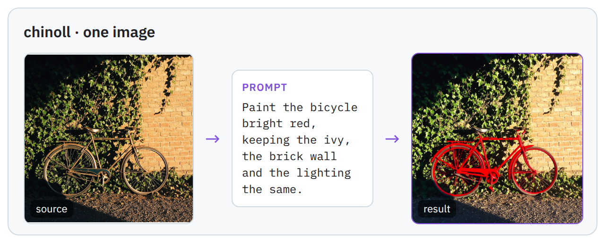
    </picture>
    <p align="center"><a href="example_workflows/moss_image_edit.json"><code>moss_image_edit.json</code></a></p>
    </td>
    <td width="50%">
    <picture>
      <source media="(prefers-color-scheme: dark)" srcset="assets/card-moss_image_edit_multi_reference-dark.png">
      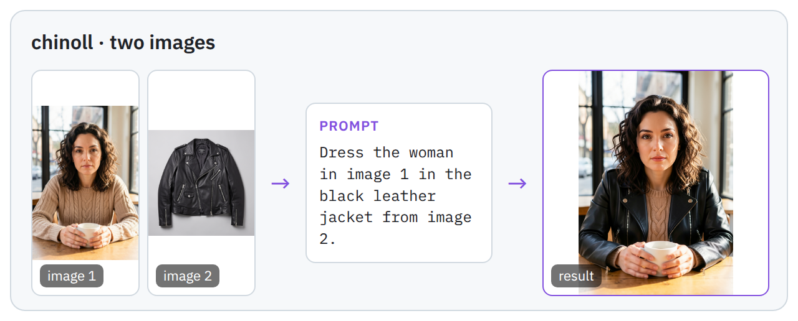
    </picture>
    <p align="center"><a href="example_workflows/moss_image_edit_multi_reference.json"><code>moss_image_edit_multi_reference.json</code></a></p>
    </td>
  </tr>
  <tr>
    <td width="50%">
    <picture>
      <source media="(prefers-color-scheme: dark)" srcset="assets/card-moss_image_edit_hq-dark.png">
      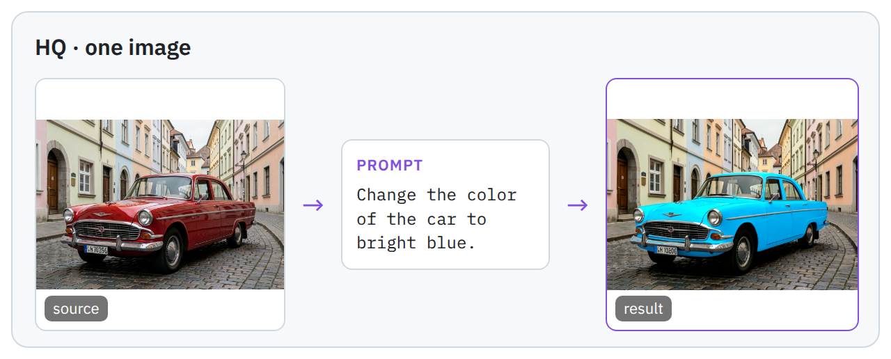
    </picture>
    <p align="center"><a href="example_workflows/moss_image_edit_hq.json"><code>moss_image_edit_hq.json</code></a></p>
    </td>
    <td width="50%">
    <picture>
      <source media="(prefers-color-scheme: dark)" srcset="assets/card-moss_image_edit_hq_multi_reference-dark.png">
      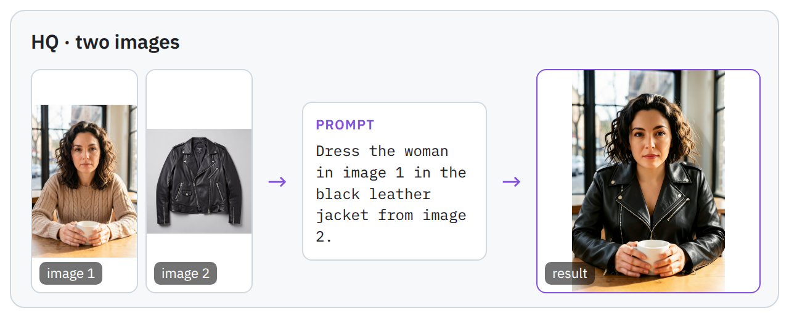
    </picture>
    <p align="center"><a href="example_workflows/moss_image_edit_hq_multi_reference.json"><code>moss_image_edit_hq_multi_reference.json</code></a></p>
    </td>
  </tr>
</table>

All four use the same graph; only the LoRA, the format and the CFG differ:

<picture>
  <source media="(prefers-color-scheme: dark)" srcset="assets/workflow-dark.png">
  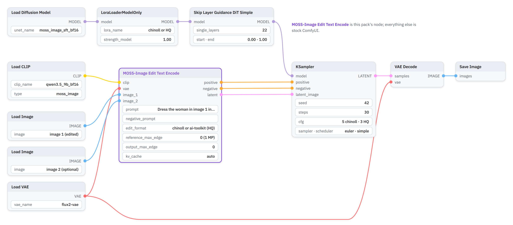
</picture>

## Gallery

Fourteen common edit types, after the categories of the [GEdit-Bench](https://github.com/stepfun-ai/Step1X-Edit) and
[ImgEdit](https://github.com/PKU-YuanGroup/ImgEdit) benchmarks. Every image uses the shipped workflow settings on
MOSS-Image SFT with **seed 42, first try, no cherry-picking**. The sources were made with FLUX.2 Klein 9B, so MOSS never
edits its own output.

The mark under each result: ✅ worked · ⚠️ partly · ❌ failed.

### Scene & style

<table>
  <tr><th width="22%">Task</th><th width="26%">Source</th><th width="26%">chinoll</th><th width="26%">HQ</th></tr>
  <tr valign="top">
    <td><b>Background</b><br><sub><i>"Replace the background with a snowy mountain landscape, keeping the woman exactly the same."</i></sub></td>
    <td>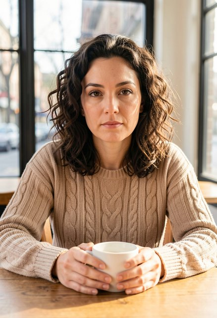</td>
    <td>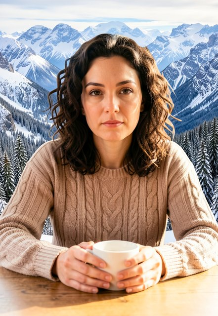<br><sub>✅ Face, hands and cup kept.</sub></td>
    <td>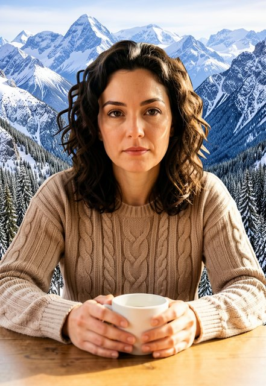<br><sub>✅ Face, hands and cup kept; a craggier range.</sub></td>
  </tr>
  <tr valign="top">
    <td><b>Time of day</b><br><sub><i>"Make it a night scene with the street lamps lit."</i></sub></td>
    <td></td>
    <td><br><sub>✅ Same street, relit.</sub></td>
    <td>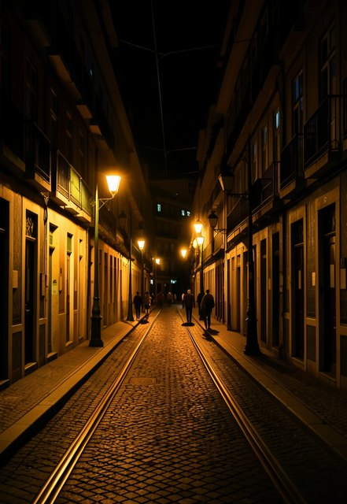<br><sub>✅ Same street, relit, a little darker.</sub></td>
  </tr>
  <tr valign="top">
    <td><b>Style</b><br><sub><i>"Turn this photo into a watercolor painting."</i></sub></td>
    <td></td>
    <td>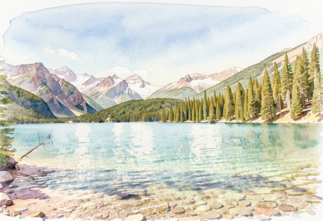<br><sub>✅ Composition kept.</sub></td>
    <td>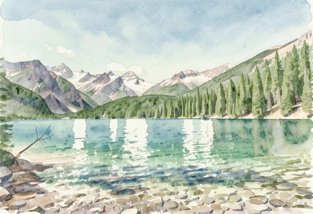<br><sub>✅ Composition kept; looser water.</sub></td>
  </tr>
</table>

### Objects

<table>
  <tr><th width="22%">Task</th><th width="26%">Source</th><th width="26%">chinoll</th><th width="26%">HQ</th></tr>
  <tr valign="top">
    <td><b>Add</b><br><sub><i>"Add a glass vase with red roses on the coffee table."</i></sub></td>
    <td>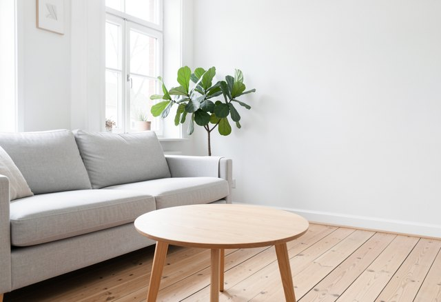</td>
    <td>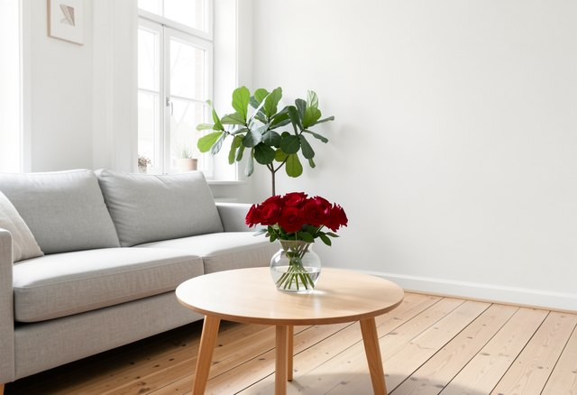<br><sub>✅ Vase on the table; the room is untouched.</sub></td>
    <td>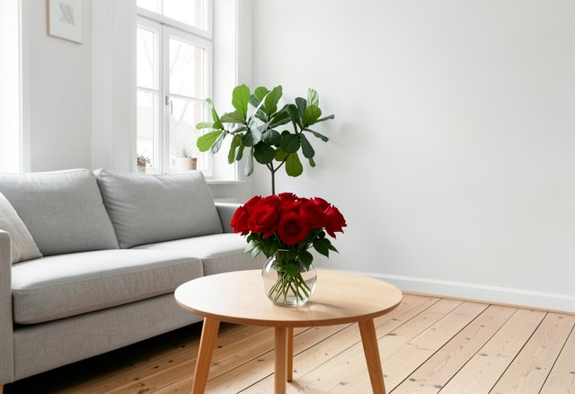<br><sub>✅ Vase on the table, with a fuller bouquet.</sub></td>
  </tr>
  <tr valign="top">
    <td><b>Remove</b><br><sub><i>"Remove the man from the beach."</i></sub></td>
    <td></td>
    <td><br><sub>❌ The man is still there at this seed.</sub></td>
    <td><br><sub>✅ Only the man goes; the umbrella stays.</sub></td>
  </tr>
  <tr valign="top">
    <td><b>Replace</b><br><sub><i>"Replace the dog with a black cat."</i></sub></td>
    <td></td>
    <td>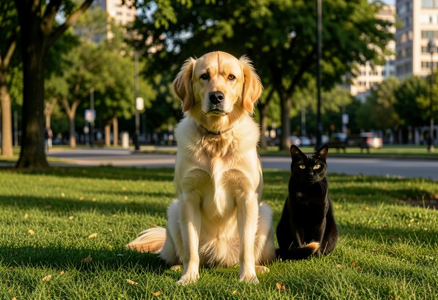<br><sub>⚠️ Adds the cat beside the dog.</sub></td>
    <td>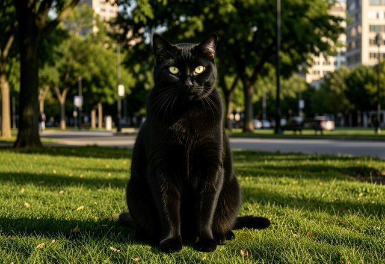<br><sub>✅ The dog becomes a black cat.</sub></td>
  </tr>
</table>

### Appearance

<table>
  <tr><th width="22%">Task</th><th width="26%">Source</th><th width="26%">chinoll</th><th width="26%">HQ</th></tr>
  <tr valign="top">
    <td><b>Color</b><br><sub><i>"Change the color of the car to bright blue."</i></sub></td>
    <td>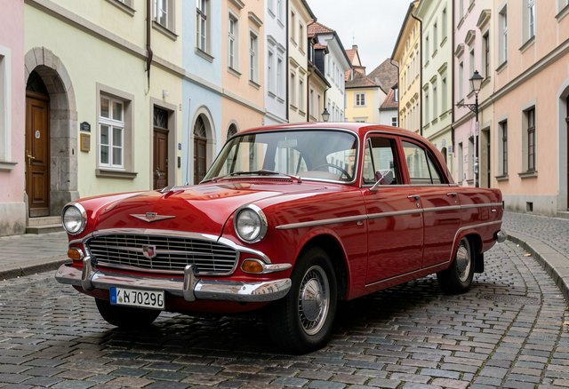</td>
    <td>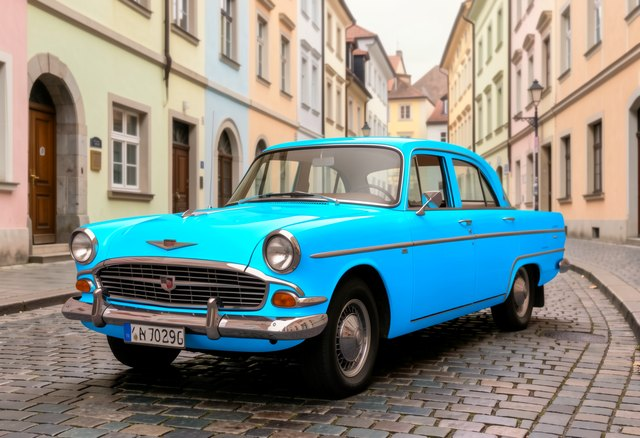<br><sub>✅ Street and chrome untouched.</sub></td>
    <td>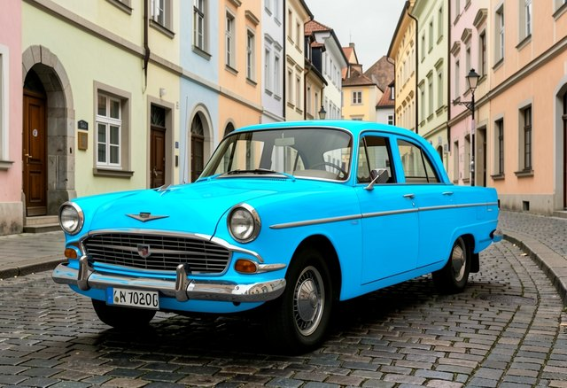<br><sub>✅ Street and chrome untouched.</sub></td>
  </tr>
  <tr valign="top">
    <td><b>Material</b><br><sub><i>"Make the statue look like it is made of polished gold."</i></sub></td>
    <td>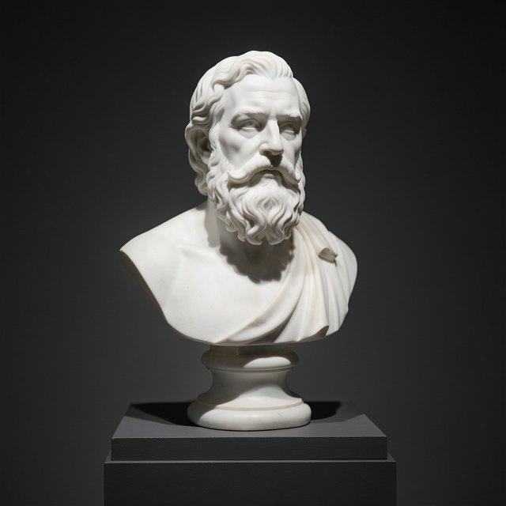</td>
    <td>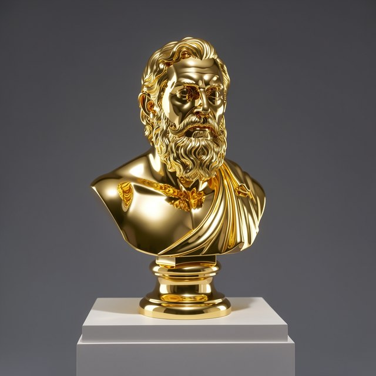<br><sub>✅ Shape kept; the pedestal and backdrop get lighter.</sub></td>
    <td>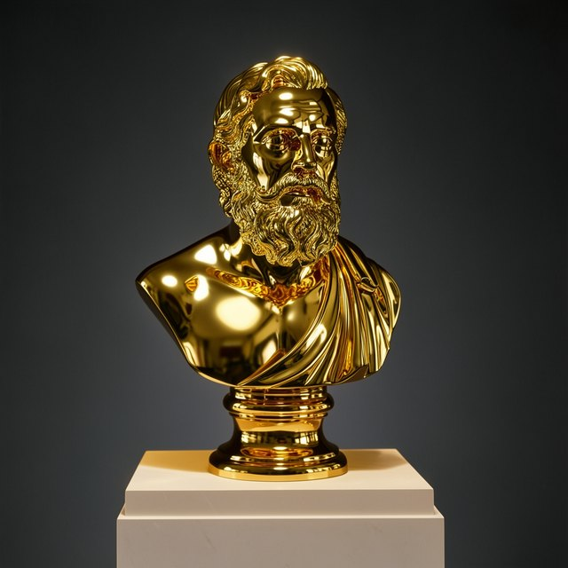<br><sub>✅ Shape kept; the pedestal gets lighter.</sub></td>
  </tr>
</table>

### People

<table>
  <tr><th width="22%">Task</th><th width="26%">Source</th><th width="26%">chinoll</th><th width="26%">HQ</th></tr>
  <tr valign="top">
    <td><b>Expression</b><br><sub><i>"Make the woman smile warmly, showing her teeth."</i></sub></td>
    <td></td>
    <td>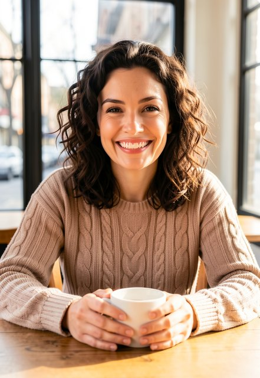<br><sub>✅ Same person, pose and hands.</sub></td>
    <td>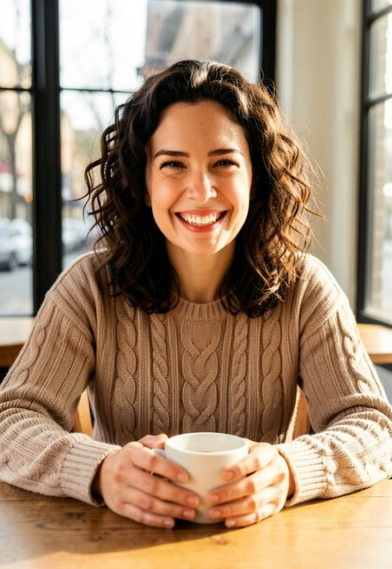<br><sub>✅ Same person, pose and hands.</sub></td>
  </tr>
  <tr valign="top">
    <td><b>Hair</b><br><sub><i>"Give the woman short straight blonde hair."</i></sub></td>
    <td></td>
    <td>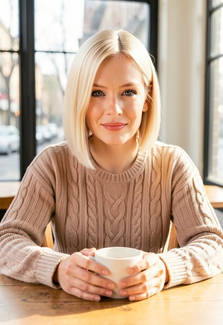<br><sub>✅ Short blonde bob.</sub></td>
    <td>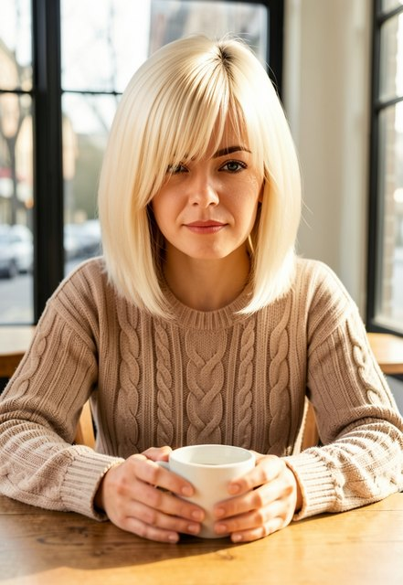<br><sub>✅ Blonde bob, longer than asked.</sub></td>
  </tr>
  <tr valign="top">
    <td><b>Accessory</b><br><sub><i>"Add black sunglasses to the woman."</i></sub></td>
    <td></td>
    <td>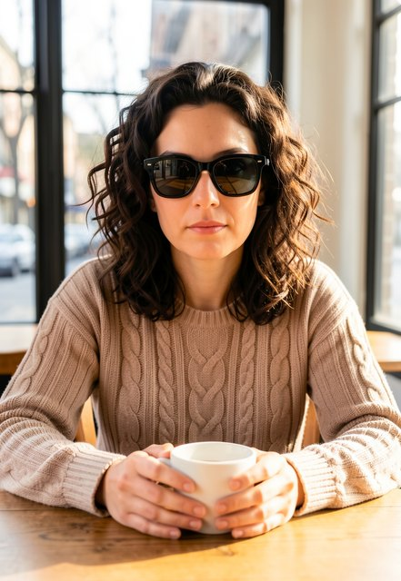<br><sub>✅ Sunglasses on; nothing else changes.</sub></td>
    <td>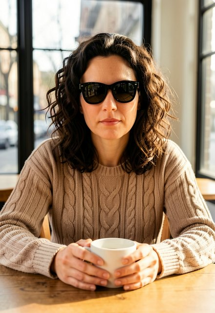<br><sub>✅ Sunglasses on; nothing else changes.</sub></td>
  </tr>
</table>

### Pose · Text

<table>
  <tr><th width="22%">Task</th><th width="26%">Source</th><th width="26%">chinoll</th><th width="26%">HQ</th></tr>
  <tr valign="top">
    <td><b>Pose</b><br><sub><i>"Make the dog lie down on the grass."</i></sub></td>
    <td>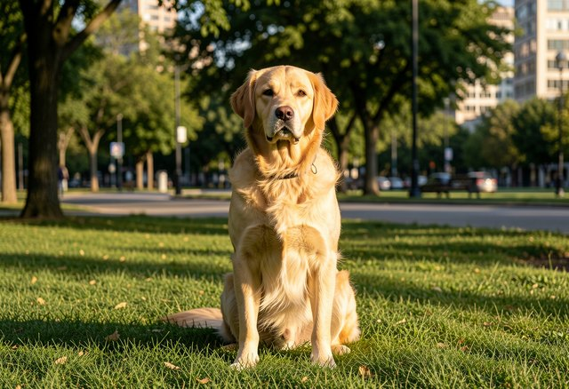</td>
    <td>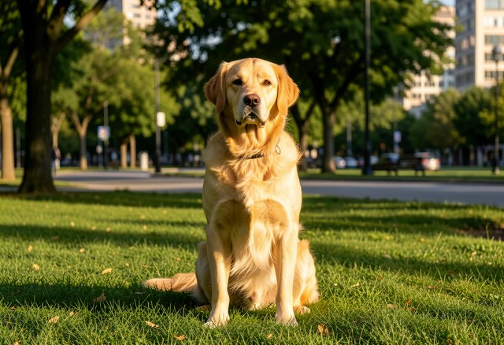<br><sub>❌ The dog stays seated.</sub></td>
    <td>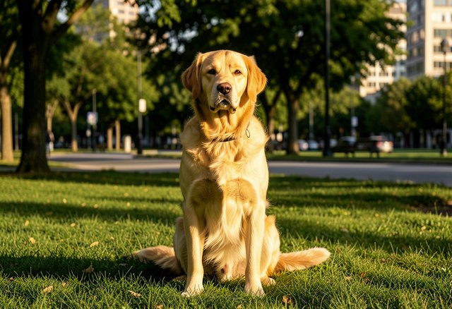<br><sub>❌ The dog stays seated.</sub></td>
  </tr>
  <tr valign="top">
    <td><b>Text</b><br><sub><i>"Change the text on the signs from "BAKERY" to "COFFEE"."</i></sub></td>
    <td>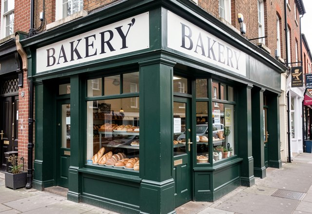</td>
    <td>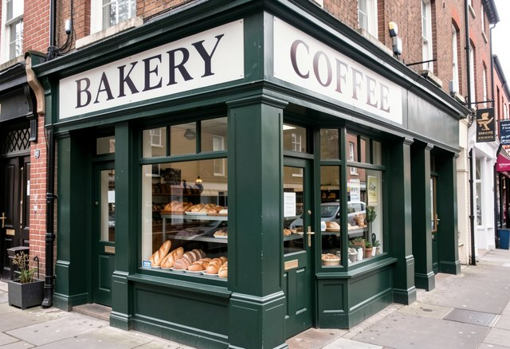<br><sub>⚠️ Only the right-hand sign changes.</sub></td>
    <td>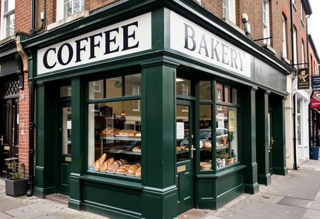<br><sub>⚠️ Only the left-hand sign changes.</sub></td>
  </tr>
</table>

### Two images

<table>
  <tr><th width="20%">Task</th><th width="20%">Image 1</th><th width="20%">Image 2</th><th width="20%">chinoll</th><th width="20%">HQ</th></tr>
  <tr valign="top">
    <td><b>Outfit</b><br><sub><i>"Dress the woman in image 1 in the black leather jacket from image 2."</i></sub></td>
    <td></td>
    <td>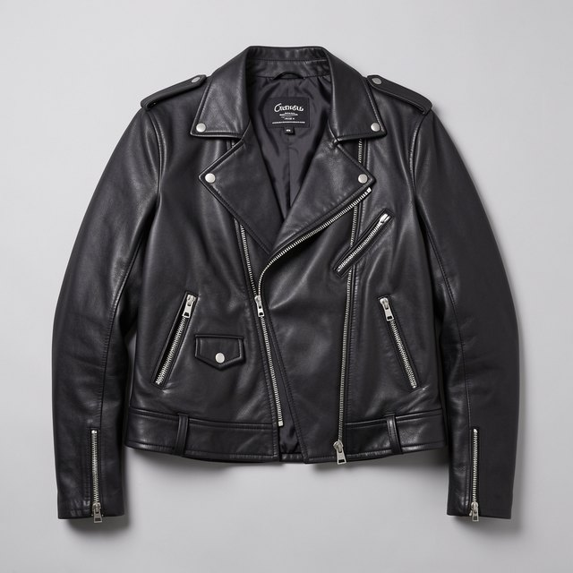</td>
    <td>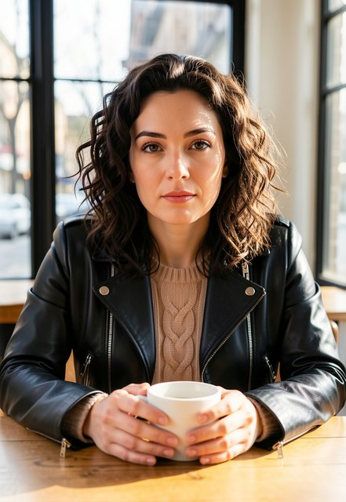<br><sub>✅ Jacket on; pose, hands and cup kept.</sub></td>
    <td>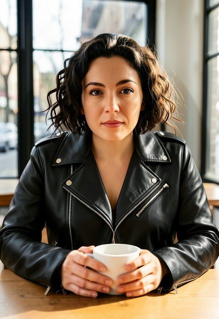<br><sub>✅ Jacket on; pose, hands and cup kept.</sub></td>
  </tr>
</table>

## Recommended settings

These are the workflows' defaults. They come from over 300 test edits on an RTX 3090: first one setting at a time on
seven edit types, then the best settings on all fourteen, on SFT and Base, with two seeds each.

| Setting | chinoll | HQ | Why |
|:--|:-:|:-:|:--|
| LoRA strength | **1.0** | **1.0** | Lower strengths redraw the scene instead of editing it |
| Image size | 1 MP bucket | 1 MP bucket | References and output the same size; `reference_max_edge` 0, `output_max_edge` 0 |
| CFG | **5** | **3** | chinoll at 4 also removes nearby objects; HQ is best at 3 |
| Negative pass | skip layer 22 | skip layer 22 | The official MOSS sampler default; slightly cleaner |
| Steps · sampler | 30 · euler / simple | 30 · euler / simple | 50 steps look the same |
| Negative prompt | empty | empty | As both were trained |
| Model | **SFT** | **SFT** | Both LoRAs were trained on SFT |

### Strength must be 1.0

At lower strengths the LoRA stops holding the source: the man stays on the beach, and a two-image edit returns
image 2 instead of combining them.

<table>
  <tr><th></th><th>0.25</th><th>0.5</th><th>0.75</th><th>1.0</th></tr>
  <tr>
    <td><b>chinoll</b><br><sub>two images</sub></td>
    <td>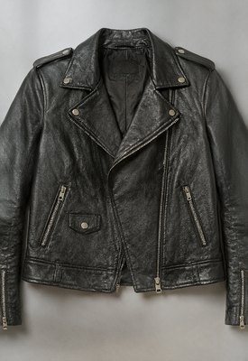</td>
    <td>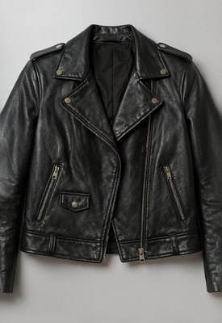</td>
    <td>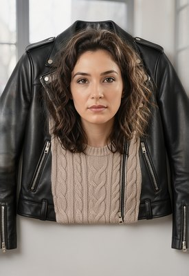</td>
    <td>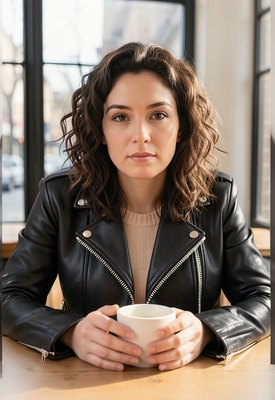</td>
  </tr>
  <tr>
    <td><b>HQ</b><br><sub>two images</sub></td>
    <td>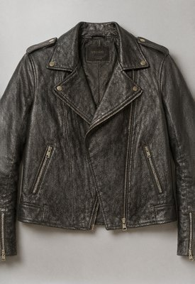</td>
    <td>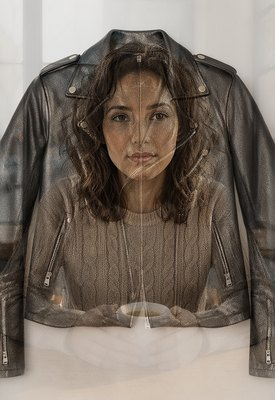</td>
    <td>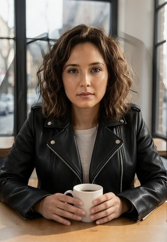</td>
    <td>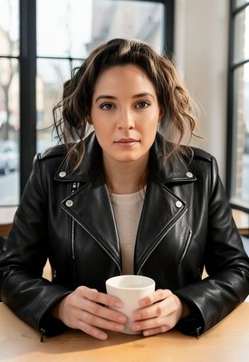</td>
  </tr>
  <tr>
    <td><b>chinoll</b><br><sub>remove the man</sub></td>
    <td>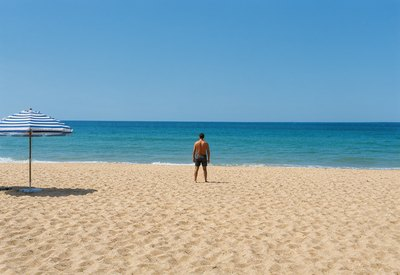</td>
    <td>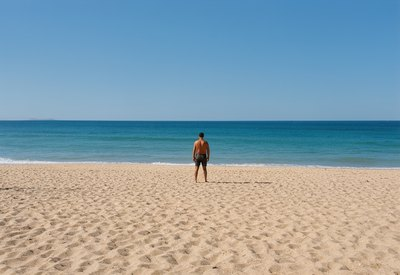</td>
    <td>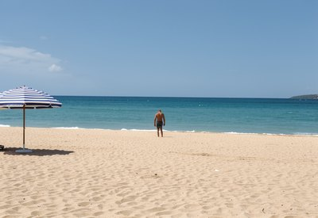</td>
    <td>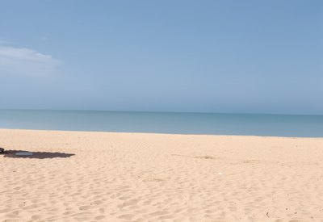</td>
  </tr>
  <tr>
    <td><b>HQ</b><br><sub>remove the man</sub></td>
    <td></td>
    <td></td>
    <td></td>
    <td></td>
  </tr>
</table>
<sub>Stage-one baseline settings: CFG 4 (chinoll) and 3 (HQ), 1024 px, no layer skip, seed 42.</sub>

### References and output the same size

chinoll was trained with source and target at the same size. Smaller references than the output zoom the scene out, or
the edit fails. HQ copes better, but also edits best with references at the output size. The default, a 1 MP bucket of
each image's aspect ratio, keeps them equal.

<table>
  <tr><th></th><th>reference 1024 → output 1024</th><th>reference 512 → output 1024</th><th>reference 512 → output 512</th></tr>
  <tr>
    <td><b>Text</b></td>
    <td></td>
    <td></td>
    <td></td>
  </tr>
  <tr>
    <td><b>Color</b></td>
    <td></td>
    <td></td>
    <td></td>
  </tr>
</table>
<sub>chinoll, stage-one baseline settings, seed 42.</sub>

### SFT, not Base

Both LoRAs were trained on MOSS-Image SFT. They load on Base and handle simple edits there, but text, subject
replacement and two-image edits fail much more often, and HQ also breaks hair edits. If you only have Base, `example_workflows/` has
`*_base` versions of the workflows.

<table>
  <tr><th></th><th>chinoll · SFT</th><th>chinoll · Base</th><th>HQ · SFT</th><th>HQ · Base</th></tr>
  <tr>
    <td><b>Text</b></td>
    <td></td>
    <td></td>
    <td></td>
    <td></td>
  </tr>
  <tr>
    <td><b>Two images</b></td>
    <td></td>
    <td></td>
    <td></td>
    <td></td>
  </tr>
  <tr>
    <td><b>Hair</b></td>
    <td></td>
    <td></td>
    <td></td>
    <td></td>
  </tr>
  <tr>
    <td><b>Replace</b></td>
    <td></td>
    <td></td>
    <td></td>
    <td></td>
  </tr>
</table>
<sub>Recommended settings at 1024 px, seed 42.</sub>

<details>
<summary>Other things tested</summary>

- **CFG** 2 to 5: chinoll is best at 5 (at 4 it removed the beach umbrella along with the man); HQ at 3, with 2 and 4 close.
- **Steps** 30 vs 50: no visible difference.
- **HQ without its images in the prompt**: text edits fail and a background change turns white. The images matter.
- **HQ `image_strength` 2**: no better than 1.
- **HQ with smaller references** (512 and 724 px, its training cap): worse text and two-image edits than full size.
- **chinoll at its 256 px training size**: edits hardest there (both signs change), but the output is only 256 px.
- **HQ on fine structures**: "paint the bicycle red" fills the wheel spokes solid red on most seeds.
</details>

Speed with the reference cache on: about 45 s for a 1 MP edit at 30 steps on an RTX 3090. On an RTX 4090: 5.0 it/s at
512² and 1.04 s/it at 1024², against 1.86 s/it with the cache off (bit-identical images).

## Nodes

### MOSS-Image Edit Text Encode

Encodes the instruction and its negative with one to four images, in the layout the LoRA was trained with.

| Input | Default | |
|:--|:-:|:--|
| `prompt` / `negative_prompt` | – / empty | The instruction. Name the images *image 1*, *image 2*…; image 1 is the one edited. |
| `edit_format` | chinoll | `Moss-Image-Edit (chinoll)` or `ai-toolkit (MOSS-Image-Edit-HQ)`. For ai-toolkit LoRAs the text encoder also sees each image (at most 384² px, as "Picture N:" before the prompt), as in training. |
| `images` | – | One to four; each batch item counts as one. |
| `reference_max_edge` | 0 | 0: each image is resized, up or down, to the 1 MP size closest to its aspect ratio (multiples of 16, no crop): 4032×3024 and 640×480 both become 1168×880. A number caps the long side instead, never upscaling. |
| `output_max_edge` | 0 | 0: the output is the size of image 1's reference. Keep the two equal. |
| `kv_cache` | auto | Keep the references' keys/values for the sampling run (about twice as fast) or recompute them every step. Same image either way. |
| `image_strength` | 1.0 | Advanced, ai-toolkit format: weights the images in the prompt. |

### MOSS-Image Edit References

The older, chinoll-only node: adds references to conditioning from `CLIPTextEncode`. ComfyUI's **Set Reference Latent**
works too, with **Edit Model Reference Method** after it set to the LoRA's layout (`index_timestep_zero_text_start` for
chinoll; references without a method take HQ's `index_timestep_zero_isolated`; the MOSS options are on ComfyUI master,
not yet in a release). The sizing is then yours, the negative needs the references too, and HQ's prompt then has no images, which
costs it text edits.

## How it works

<details>
<summary>The edit layouts, the model hooks and the reference cache</summary>

Both layouts run the reference latents through the same 42 blocks at timestep 0, on RoPE axis r = image index + 1
with their rows and columns centered, attending only to each other. The target and text keep the stock joint attention
and timestep, and also attend to the references' keys/values in every block. They differ on the f axis:

- chinoll's references sit at the text's start (f = 0), as in its training code (`moss_runtime/model.py`);
- ai-toolkit's sit at the image's frame (f = text length), as in ai-toolkit's `moss_image` transformer. The image and
  text are shifted by −text length instead, which RoPE cannot tell apart, so the references' keys don't depend on the
  prompt.

`moss_edit/patches.py` adds this to ComfyUI's model. `model_base.MOSSImage` passes the conditioning's references, their
layout (`reference_latents_method`) and the image weights (`context_attention_bias`) to the DiT, and counts the
reference tokens in the memory estimate. The DiT takes the edit path (`moss_edit/model.py`) only when references are
present, so text-to-image is untouched. The edit path reuses the native block pieces (fused RMSNorm-AdaLN and
RMSNorm-RoPE kernels, fused situ, fused qkv, ComfyUI attention including int8, dynamic-VRAM prefetching, the memory
compiler region) and passes block patches such as skip layer guidance through.

The reference branch never sees the text or the target, so its keys/values are the same at every step, for cond and
uncond, and in both layouts. They are computed once per sampling run and reused: 42 × 2 × tokens × 3072 values, about
0.5 MB per reference token in bf16 (2 GB for a 1 MP reference). The cache is freed when sampling ends. `auto` keeps it
when it fits in half the free memory, counting dynamic-VRAM weights that can be evicted. Set `kv_cache` to `off` for
LoRA schedules (hooks) that change the weights during sampling.

**With ComfyUI's own MOSS edit support.** ComfyUI master supports MOSS edit LoRAs itself (not yet in a release; 0.42.5
doesn't have it) ([#17296](https://github.com/Comfy-Org/ComfyUI/pull/17296), [#17320](https://github.com/Comfy-Org/ComfyUI/pull/17320)).
There the pack's model hooks stand down and ComfyUI's code runs the references. The nodes, the sizing, the LoRA
conversion and the workflows keep working, since they use ComfyUI's conditioning keys and method names. ComfyUI's code
always keeps the reference keys/values, so `kv_cache` has no effect there.
</details>

## Tests

<details>
<summary>CPU tests against the training code and ComfyUI's own implementation</summary>

- `tests/test_equivalence.py`: the edit forward against the code each LoRA was trained with, same random weights,
  float32: upstream's `MossEditModel` on the official `MOSSImageTransformer` (chinoll's layout) and ai-toolkit's
  `MossImageTransformer` with `isolate_refs` (HQ's layout). Unfused and fused qkv, one or two references of different
  sizes, cached and uncached, cond and uncond of different lengths sharing one cache, cache invalidation between runs,
  mixed-reference batches, block replacement. Agreement ~1e-6.
- `tests/test_lora_keys.py`: every LoRA tensor (converted and raw) maps onto the native model, unfused and fused.
- `tests/test_conditioning_path.py`: the nodes' conditioning through `extra_conds` and the DiT, saved on a ComfyUI with
  native MOSS edit support and compared on one without (this pack's hooks), for both layouts and the image weights:
  ~3e-7.

```bash
CUDA_VISIBLE_DEVICES="" ComfyUI/.venv/bin/python tests/test_equivalence.py --comfy ComfyUI \
    --pipeline MOSS-Image-SFT/pipeline_moss_image.py --upstream <Chenkin-x/ComfyUI-Moss-Image-Edit at f70d118> \
    --aitk <ai-toolkit at 14f8f95>/extensions_built_in/diffusion_models/moss_image/src/transformer.py
CUDA_VISIBLE_DEVICES="" ComfyUI/.venv/bin/python tests/test_lora_keys.py --comfy ComfyUI \
    --model ComfyUI/models/diffusion_models/moss_image_sft_bf16.safetensors \
    --converted ComfyUI/models/loras/moss_image_edit_lora_bf16.safetensors --raw /tmp/moss-edit/adapter_model.safetensors
CUDA_VISIBLE_DEVICES="" ComfyUI/.venv/bin/python tests/test_conditioning_path.py --comfy <ComfyUI master> ... --save native.pt
CUDA_VISIBLE_DEVICES="" ComfyUI/.venv/bin/python tests/test_conditioning_path.py --comfy ComfyUI ... --compare native.pt
```
</details>

## Credits and license

Made by [PedroMarinhoDev](https://github.com/PedroMarinhoDev).

The LoRAs were trained by [chinoll](https://huggingface.co/chinoll) / [Chenkin-x](https://github.com/Chenkin-x)
([Moss-Image-Edit](https://github.com/Chenkin-x/Moss-Image-Edit)) and by [akhaliq](https://huggingface.co/akhaliq)
([MOSS-Image-Edit-HQ](https://huggingface.co/akhaliq/MOSS-Image-Edit-HQ), Apache-2.0, with
[ai-toolkit](https://github.com/ostris/ai-toolkit)), on [MOSS-Image](https://huggingface.co/OpenMOSS-Team/MOSS-Image-SFT)
by OpenMOSS. The example images were generated with FLUX.2 Klein.

Licensed GPL-3.0, like ComfyUI and the upstream nodes.
