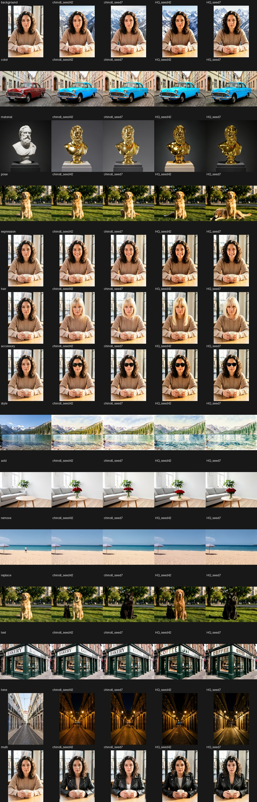
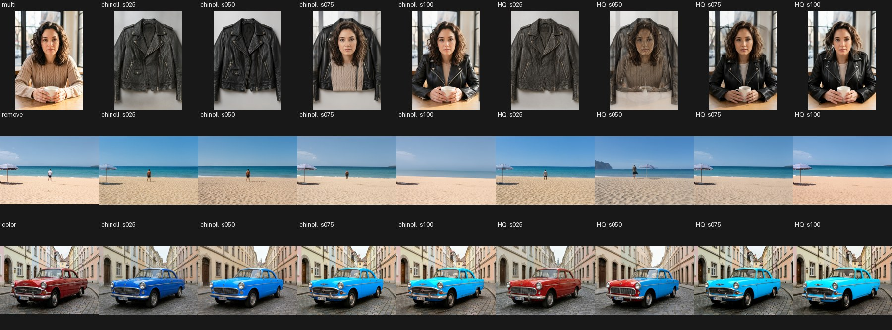
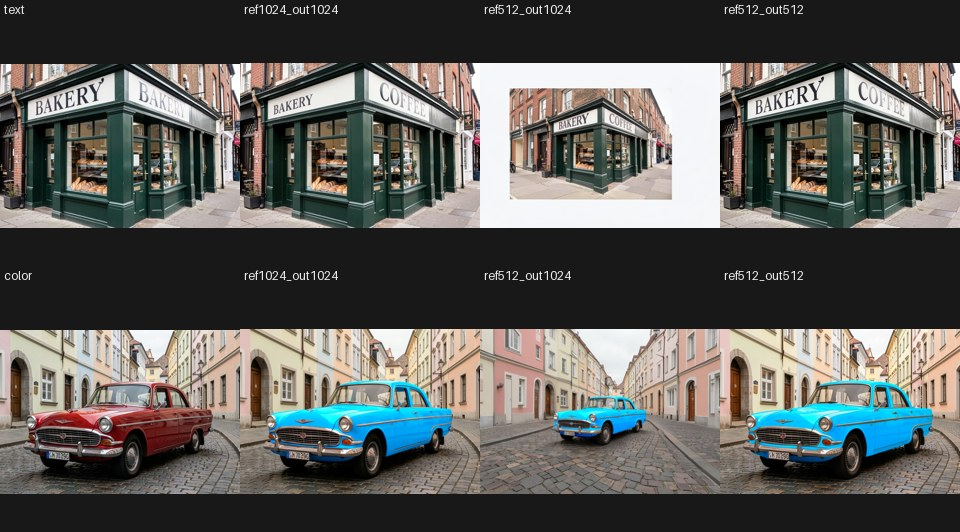
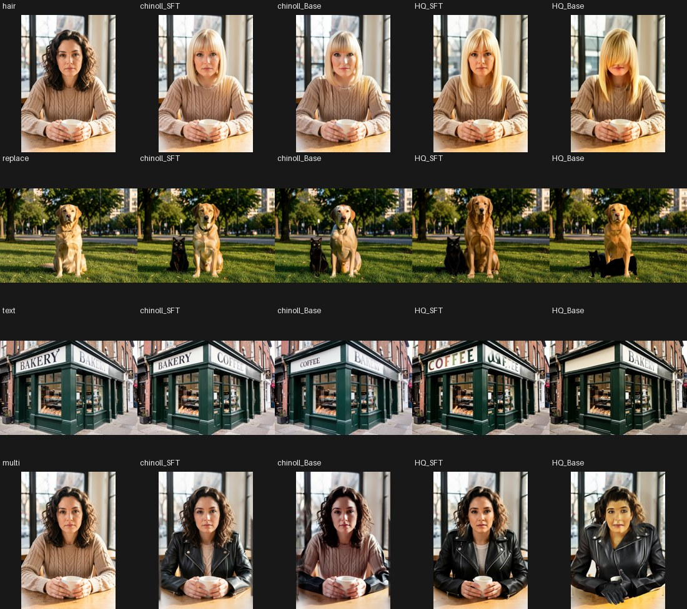

# ComfyUI-Moss-Image-Edit-Native

Instruction image editing with MOSS-Image edit LoRAs on ComfyUI's **native** MOSS-Image model: edit one image, or
combine up to four, with a text instruction. Two LoRAs are supported, each in the layout it was trained with:

| LoRA | trained with | format in this pack |
|:--|:--|:--|
| [chinoll/Moss-Image-Edit](https://huggingface.co/chinoll/Moss-Image-Edit) | Chenkin-x's own trainer, 256 px, one reference | `Moss-Image-Edit (chinoll)` |
| [akhaliq/MOSS-Image-Edit-HQ](https://huggingface.co/akhaliq/MOSS-Image-Edit-HQ) (`armV3`) | ai-toolkit edit mode with `kv_cache`, references also shown to the text encoder | `ai-toolkit (MOSS-Image-Edit-HQ)` |

Everything else is stock ComfyUI: loaders, `LoraLoaderModelOnly`, samplers, model patches and memory management (smart
and dynamic VRAM, prefetching, partial offload). No dependencies beyond ComfyUI.



*14 common edit types (after the [GEdit-Bench](https://github.com/stepfun-ai/Step1X-Edit) and
[ImgEdit](https://github.com/PKU-YuanGroup/ImgEdit) categories) on MOSS-Image SFT with the recommended settings. Columns:
source, chinoll (seeds 42, 7), HQ (seeds 42, 7). Sources made with FLUX.2 Klein 9B, so MOSS never edits its own output.*

## Install

```bash
cd ComfyUI/custom_nodes
git clone https://github.com/PedroMarinhoDev/ComfyUI-Moss-Image-Edit-Native
```

| folder | file |
|:--|:--|
| `diffusion_models` | `moss_image_sft_bf16` or `moss_image_sft_int8_convrot` from [Comfy-Org/MOSS-Image](https://huggingface.co/Comfy-Org/MOSS-Image) (Base works, worse: see below) |
| `text_encoders` | `qwen3.5_9b_bf16` or `qwen3.5_9b_w4a8_gptq` (with the vision tower, which HQ uses) |
| `vae` | `flux2-vae_small` (MOSS's decoder) or `flux2-vae`; the encoders are identical |
| `loras` | chinoll: `moss_image_edit_lora_bf16.safetensors` from [PedroMarinhoDev/Moss-Image-Edit-ComfyUI](https://huggingface.co/PedroMarinhoDev/Moss-Image-Edit-ComfyUI) |
| `loras` | HQ: [`weights/armV3/armV3.safetensors`](https://huggingface.co/akhaliq/MOSS-Image-Edit-HQ/blob/main/weights/armV3/armV3.safetensors) as it is (the workflows call it `moss_image_edit_hq_armV3.safetensors`) |

```bash
hf download PedroMarinhoDev/Moss-Image-Edit-ComfyUI moss_image_edit_lora_bf16.safetensors --local-dir ComfyUI/models/loras
hf download akhaliq/MOSS-Image-Edit-HQ weights/armV3/armV3.safetensors --local-dir /tmp/hq && \
  mv /tmp/hq/weights/armV3/armV3.safetensors ComfyUI/models/loras/moss_image_edit_hq_armV3.safetensors
```

chinoll's file is the original adapter with its keys renamed (tensors unchanged); `tools/convert_lora.py` makes it from
the published `adapter_model.safetensors` (it checks the sha256, targets, shapes and rank/alpha), and with this pack
installed the unconverted file loads too. HQ's ai-toolkit file loads as it is. ComfyUI maps the q/k/v parts onto the
fused `qkv` of the repacked models itself.

## Use

Open a workflow from **Templates → ComfyUI-Moss-Image-Edit-Native** or drop one from [`example_workflows/`](example_workflows):

| | one image | two images |
|:--|:--|:--|
| chinoll on SFT | [`moss_image_edit`](example_workflows/moss_image_edit.json) | [`moss_image_edit_multi_reference`](example_workflows/moss_image_edit_multi_reference.json) |
| HQ on SFT | [`moss_image_edit_hq`](example_workflows/moss_image_edit_hq.json) | [`moss_image_edit_hq_multi_reference`](example_workflows/moss_image_edit_hq_multi_reference.json) |
| chinoll on Base | [`moss_image_edit_base`](example_workflows/moss_image_edit_base.json) | [`moss_image_edit_base_multi_reference`](example_workflows/moss_image_edit_base_multi_reference.json) |
| HQ on Base | [`moss_image_edit_hq_base`](example_workflows/moss_image_edit_hq_base.json) | [`moss_image_edit_hq_base_multi_reference`](example_workflows/moss_image_edit_hq_base_multi_reference.json) |

They load the images in [`example_inputs/`](example_inputs) (copy them to `ComfyUI/input`, or pick your own):

```
UNETLoader → LoraLoaderModelOnly (1.0) → SkipLayerGuidanceDiTSimple (layer 22) ──────────────┐
CLIPLoader (moss_image) ─┐                                                                    │
VAELoader ───────────────┼→ MOSS-Image Edit Text Encode → positive, negative, latent → KSampler → VAEDecode
LoadImage(s) ────────────┘    (instruction, format, images)
```

**MOSS-Image Edit Text Encode** encodes the instruction and the negative with one to four images (image 1 is the one
being edited; name them in the prompt: *"Dress the woman in image 1 in the jacket from image 2"*):

- `edit_format`: the layout the LoRA was trained with. For ai-toolkit LoRAs (HQ) the text encoder also sees each image,
  at most 384² px, as "Picture N:" before the prompt, in both the positive and the negative, as ai-toolkit trains.
- `reference_max_edge` 1024 (Lanczos, sides rounded to 16, no crop) and `output_max_edge` 0: the output latent is the
  size of image 1's reference. Keep them equal, see below.
- `kv_cache`: keep the references' keys/values for the sampling run (about twice as fast) or recompute them every step.
  Same image either way.
- `image_strength` (advanced, HQ): weights the images in the prompt; 1 is as trained.

**MOSS-Image Edit References** is the older chinoll-only node that adds references to conditioning from
`CLIPTextEncode`. ComfyUI's **Set Reference Latent** works too, with **Edit Model Reference Method** after it set to
the LoRA's layout (`index_timestep_zero_text_start` for chinoll; without a method references take HQ's
`index_timestep_zero_isolated`; the MOSS options are in ComfyUI after 0.42.1). The sizing is then yours, the negative needs the references too, and for HQ the prompt
has no images, which costs it text edits.

## Recommended settings

Tested on the RTX 3090 with `moss_image_sft_bf16`, `qwen3.5_9b_bf16` and `flux2-vae`: first one change at a time from a
baseline on 7 edit types (background, colour, add, remove, text, style, two images), then the best settings on 14 edit
types, SFT and Base, two seeds each. The test scripts and every image are in a separate lab folder, not in this repo.

| | chinoll | HQ |
|:--|:--|:--|
| LoRA strength | **1.0** | **1.0** |
| references / output | same size, 1024 | same size, 1024 |
| CFG | **5** | **3** |
| negative pass | skip layer 22 (the official MOSS sampler default) | skip layer 22 (ai-toolkit's default) |
| steps, sampler | 30, euler / simple | 30, euler / simple |
| negative prompt | empty | empty (with the images) |
| model | **SFT** | **SFT** |

What the tests showed:

- **Strength 1.0.** Below it both LoRAs redraw the scene instead of editing it, removals don't happen and two-image
  edits return image 2 (the jacket): 
- **References the size of the output.** chinoll trained source and target at one size; with 512 px references and a
  1024 px output the scene zooms out or the edit fails. Matched sizes work at 256 to 1024 (chinoll edits hardest at its
  256 px training size, 1024 looks best). HQ was trained with references up to 0.5 MP, but 512 and 724 px references
  gave worse text and two-image edits than 1024. 
- **CFG:** chinoll at 5 removes only what it is asked to (at 4 it also took the beach umbrella); HQ at 3, with 2 and 4
  close. Skipping layer 22 on the negative pass helps a little. 50 steps look the same as 30.
- **HQ needs its images in the prompt:** without them text edits fail and backgrounds turn white. `image_strength` 2
  is no better than 1.
- **chinoll vs HQ on SFT:** close. chinoll keeps identity and the untouched areas better; HQ is better at text (both
  signs, where chinoll changes one), more saturated, and on fine structures can overpaint ("paint the bicycle red" fills
  the wheel spokes on most seeds). Both are weak at pose changes and at replacing one subject with another, where they
  often add the new subject beside the old one.
- **SFT, not Base:** both LoRAs were trained on SFT. On Base, text, subject replacement and two-image edits fail much
  more often (HQ also breaks hair edits): 

Speed (cache on): about 45 s for a 1024 px edit at 30 steps on the RTX 3090; on the RTX 4090 5.0 it/s at 512² and
1.04 s/it at 1024², 1.86 s/it with the cache off (bit-identical images), against 4.7 it/s for text-to-image at 512².

## How it works

Both layouts run the reference latents through the same 42 blocks at timestep 0, on RoPE axis r = image index + 1 with
their rows and columns centered, attending only to each other; the target and text keep the stock joint attention and
timestep, and also attend to the references' keys/values in every block. They differ on the f axis: chinoll's
references sit at the text's start (f = 0, from upstream's `moss_runtime/model.py`), ai-toolkit's at the image's frame
(f = text length, from ai-toolkit's `moss_image` transformer). For the latter the image and text are shifted by −text
length instead, which RoPE cannot tell apart, so the references' keys stay independent of the prompt.

`moss_edit/patches.py` adds this to ComfyUI's model: `model_base.MOSSImage` passes the conditioning's references, their
layout (`reference_latents_method`) and the image-token weights (`context_attention_bias`) to the DiT and counts the
reference tokens in the memory estimate, and the DiT takes the edit path (`moss_edit/model.py`) only when references are
present; text-to-image is untouched. The edit path reuses the native block pieces (fused RMSNorm-AdaLN and RMSNorm-RoPE
kernels, fused situ, fused qkv, ComfyUI attention including int8, dynamic-VRAM prefetching, the memory compiler region)
and passes block patches such as skip layer guidance through.

The reference branch never sees the text or the target, so its keys/values are the same for every step, for cond and
uncond and for both layouts: they are computed once per sampling run and reused (42 × 2 × tokens × 3072 values, about
0.5 MB per reference token in bf16, 2 GB for a 1024² reference). The cache is freed when sampling ends; `auto` keeps it
when it takes at most half the free memory (counting dynamic-VRAM weights that can be evicted). Set `kv_cache` to `off`
for LoRA schedules (hooks) that change the weights during sampling.

### With ComfyUI's own MOSS edit support

ComfyUI after 0.42.1 supports MOSS edit LoRAs itself ([#17296](https://github.com/Comfy-Org/ComfyUI/pull/17296),
[#17320](https://github.com/Comfy-Org/ComfyUI/pull/17320)). There this pack's model hooks stand down and ComfyUI's code
runs the references; the nodes, their sizing, the LoRA conversion and the workflows keep working, since they use
ComfyUI's own conditioning keys and method names. ComfyUI's code always keeps the reference keys/values, so `kv_cache`
has no effect there.

## Tests (CPU only)

- `tests/test_equivalence.py`: the edit forward against the code each LoRA was trained with, same random weights,
  float32: upstream's `MossEditModel` on the official `MOSSImageTransformer` (chinoll's layout) and ai-toolkit's
  `MossImageTransformer` with `isolate_refs` (HQ's layout). Unfused and fused qkv, one or two references of different
  sizes, cached and uncached, cond and uncond of different lengths sharing one cache, cache invalidation between runs,
  mixed-reference batches, block replacement. Agreement ~1e-6.
- `tests/test_lora_keys.py`: every LoRA tensor (converted and raw) maps onto the native model, unfused and fused.
- `tests/test_conditioning_path.py`: the nodes' conditioning through `extra_conds` and the DiT. Saved on a ComfyUI with
  native MOSS edit support and compared on one without (this pack's hooks), for both layouts and the image-token
  weights: ~3e-7.

```bash
CUDA_VISIBLE_DEVICES="" ComfyUI/.venv/bin/python tests/test_equivalence.py --comfy ComfyUI \
    --pipeline MOSS-Image-SFT/pipeline_moss_image.py --upstream <Chenkin-x/ComfyUI-Moss-Image-Edit at f70d118> \
    --aitk <ai-toolkit at 14f8f95>/extensions_built_in/diffusion_models/moss_image/src/transformer.py
CUDA_VISIBLE_DEVICES="" ComfyUI/.venv/bin/python tests/test_lora_keys.py --comfy ComfyUI \
    --model ComfyUI/models/diffusion_models/moss_image_sft_bf16.safetensors \
    --converted ComfyUI/models/loras/moss_image_edit_lora_bf16.safetensors --raw /tmp/moss-edit/adapter_model.safetensors
CUDA_VISIBLE_DEVICES="" ComfyUI/.venv/bin/python tests/test_conditioning_path.py --comfy <ComfyUI master> ... --save native.pt
CUDA_VISIBLE_DEVICES="" ComfyUI/.venv/bin/python tests/test_conditioning_path.py --comfy ComfyUI ... --compare native.pt
```

## Credits and license

The LoRAs were trained by [chinoll](https://huggingface.co/chinoll) / [Chenkin-x](https://github.com/Chenkin-x)
([Moss-Image-Edit](https://github.com/Chenkin-x/Moss-Image-Edit)) and by [akhaliq](https://huggingface.co/akhaliq)
([MOSS-Image-Edit-HQ](https://huggingface.co/akhaliq/MOSS-Image-Edit-HQ), Apache-2.0, with
[ai-toolkit](https://github.com/ostris/ai-toolkit)) on [MOSS-Image](https://huggingface.co/OpenMOSS-Team/MOSS-Image-SFT)
by OpenMOSS. The example images were generated with FLUX.2 Klein.

Licensed GPL-3.0, like ComfyUI and the upstream nodes.
